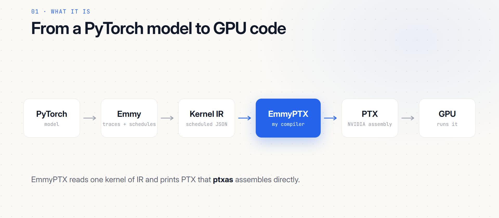
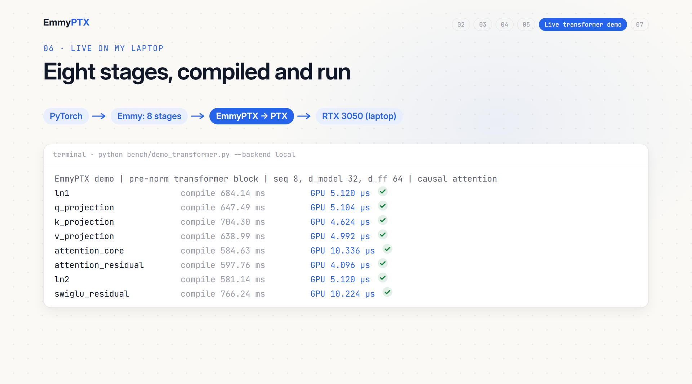
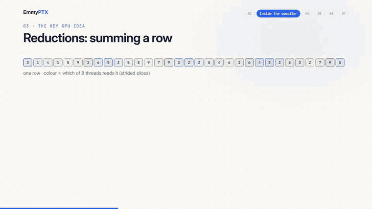

<div align="center">

# EmmyPTX

**A compiler from Emmy's scheduled Kernel IR straight to NVIDIA PTX, written from scratch in Python.**

No CUDA C++. No nvcc. No NVRTC. No LLVM. Just IR in, PTX out.

[](#quick-start)
[](#results)
[](#results)
[](#reproduce-everything)
[](https://riftstack.ai/hackathon)



</div>

---

## Why this exists

[Emmy](https://riftstack.ai/hackathon) traces a PyTorch model and schedules every GPU kernel: tiling,
cooperative reductions, pipelining. It writes that schedule down as a **Kernel IR** in JSON.

EmmyPTX takes one kernel of that IR and emits PTX that `ptxas` assembles directly. The whole lowering
(about 2,200 lines in [`emmyptx/`](emmyptx)) is our own code. Emmy is only used to deserialize the
JSON (`Graph.from_dict`). Nothing else compiles anything.

```bash
python compile.py kernel.ir.json > kernel.ptx
```

## At a glance

| | |
|---|---|
| **Original hackathon problems** | **193 / 193** pass on the organisers' RTX 5090 runner |
| **Expanded suite** | **246 / 248** pass (open set, 227 generated variants, 6 synthetic IRs) |
| **Deep learning probes** | 76 tried, 55 generated by Emmy, **53 pass** on the GPU |
| **vs Emmy + NVRTC 12.8** | matmul 1024: **1.28x faster**; attention, sequence 64: **1.80x faster** |
| **Compile time** | 737 ms fresh process vs 890 ms for NVRTC; **2.1 ms** lowering once the IR is loaded |
| **End to end** | a full pre-norm transformer block matches PyTorch to ~2e-7, on an RTX 3050 laptop and an RTX 5090 |

Every number above comes from a file in this repository. The two failing cases are kept in the suite and
explained [below](#honest-limitations).

## Quick start

```bash
pip install emmy-ml==0.3.11 numpy
python compile.py tests/open/p00_scalar_add/k_add_pointwise.ir.json
```

That kernel adds two arrays. The IR:

```text
Tile[a0] (N=64)
    in0__u0 = load x0[((a0 * 2) + 0)]
    in1__u0 = load x1[((a0 * 2) + 0)]
    f32 v0__u0 = add(in0__u0, in1__u0)
    ...
    add[((a0 * 2) + 0)] = (v0__u0, v0__u1)
```

and the heart of the PTX EmmyPTX prints for it:

```ptx
    mad.lo.s32               %r6, %r2, %r3, %r1;      // global thread index
    setp.ge.s32              %p1, %r6, 64;            // tail guard, only when needed
    @%p1 bra                 $L_exit_1;
    ...
    ld.global.nc.v2.f32      {%f1, %f2}, [%rd8];      // two floats per load
    ld.global.nc.v2.f32      {%f3, %f4}, [%rd9];
    add.rn.f32               %f5, %f1, %f3;           // correctly rounded, never fused
    add.rn.f32               %f6, %f2, %f4;
    st.global.v2.f32         [%rd10], {%f5, %f6};
```

Parameter order, block size, the tail guard and dynamic shared memory all come from the problem's
`meta.json`, which is the launch contract the runner uses.

## Results

All problems run on the hackathon's remote runner (RTX 5090): compile, assemble with `ptxas`, launch with
`meta.json`'s geometry, compare with `expected.npz`.

| Category | Open set | Generated variants | Synthetic IR |
|---|:---:|:---:|:---:|
| 1 · Pointwise | 4/4 | 69/69 | 4/4 |
| 2 · Reductions | 4/4 | 46/46 | 2/2 |
| 3 · Matmul | 2/2 | 41/41 | - |
| 4 · Fused | 3/3 | 47/47 | - |
| 5 · Attention-like | 2/2 | 22/24 | - |

**Generated variants** stand in for the hidden set. They are 227 torch expressions traced and packaged by
the organisers' own `tools/generate.py`: odd sizes, sizes that do not divide the block, f16 / f64 / int32 /
int64, broadcasting, new ops (exp, log, tanh, sigmoid, silu, gelu, erf, sin, cos, pow, where, clamp …),
other reduction axes, split reductions with atomics, MLPs, layernorm, softmax and attention of many shapes.

**Synthetic IRs** ([`tests/synthetic.py`](tests/synthetic.py)) are hand-built from Emmy's statement classes
for forms the generator never produced, so every statement kind in the compiler has run on a GPU.

Full tables: [RESULTS.md](RESULTS.md) · [GPU report](docs/gpu_results.md) · [implementation report](docs/IMPLEMENTATION_REPORT.md)

## Deep learning coverage

We went through the primitives of a deep learning course and probed 76 of them at a regular `8×32` shape
and an awkward `3×17` shape.

| | Passing on the GPU |
|---|---|
| **Language models** | embedding gather, RoPE (both halves), LayerNorm, RMSNorm, softmax, SwiGLU, GELU MLPs, scaled / biased attention, KV-cache single-query attention, odd-size causal attention, dense cross-entropy |
| **Vision** | convolution and ViT patch embedding as matmuls over prepared windows, avg / max pooling over windows, global average pooling (flattened), inference BatchNorm, channel affine |
| **Audio and other** | mel-style log features, cumsum, residual and L2 normalisation, cosine similarity, masking |

Every attempt, including the 21 that Emmy could not trace or package, is listed with its exact error in
[DL_COVERAGE.md](docs/DL_COVERAGE.md). Gaps found in the IR, with a proposed implementation for each,
are in the [IR wishlist](docs/IR_WISHLIST.md).

## EmmyPTX vs NVIDIA's compiler

There is no `nvcc` binary on the development machine, so the baseline is **Emmy's own CUDA for the same
scheduled IR, compiled by NVRTC 12.8** (NVIDIA's CUDA compiler as a library). Both sides use the same IR,
the same launch and the same RTX 5090, with fast math off and outputs fully checked.


| Workload | EmmyPTX | Emmy + NVRTC | |
|---|---:|---:|---|
| matmul 1024 × 1024 | 78.5 µs | 100.8 µs | **1.28x faster** |
| matmul 512 × 512 | 23.4 µs | 29.5 µs | **1.26x faster** |
| attention, sequence 64 | 84.6 µs | 152.2 µs | **1.80x faster** |
| attention, sequence 16 | 51.8 µs | 35.4 µs | NVRTC 1.46x faster |
| softmax, width 512 | 3.6 µs | 3.1 µs | NVRTC 1.15x faster |

Small kernels are essentially tied. We report losses as plainly as wins and do not claim causes without
profiling. All 29 workloads, raw samples and versions: [RESULTS_nvcc.md](docs/bench/RESULTS_nvcc.md).


| Compile time (median of 29 workloads) | EmmyPTX | Emmy + NVRTC |
|---|---:|---:|
| Fresh process, IR to PTX | 737 ms | 890 ms |
| Lowering only, IR already loaded | 2.1 ms | 39.5 ms (NVRTC call) |

## End-to-end demo: a transformer block

A full **pre-norm transformer block** (LayerNorm, causal attention with Q/K/V projections, residual,
LayerNorm, SwiGLU feed-forward, residual) is defined in PyTorch, traced by Emmy into eight stages,
compiled by EmmyPTX and run on the GPU. The final output is compared with PyTorch running the same block.

```bash
python bench/demo_transformer.py --backend local     # your own GPU
python bench/demo_transformer.py --backend remote    # the organisers' runner
```



| GPU | Max absolute error vs PyTorch | |
|---|---:|---|
| RTX 3050 Laptop (local) | 1.9e-7 | **PASS** |
| RTX 5090 (organisers' runner) | 2.1e-7 | **PASS** |

Results and exact console output: [demo_transformer_result.json](docs/demo_transformer_result.json).
For the laptop GPU the demo rewrites only its in-memory PTX target from sm_89 to sm_86; the compiler
itself always emits sm_89.
A smaller two-layer MLP demo is in [`bench/demo_e2e.py`](bench/demo_e2e.py).

## How it works

```
  kernel.ir.json + meta.json
            │
            ▼
  loader.py      IR via Graph.from_dict; buffers, parameter order, launch geometry
            │
            ▼
  analysis.py    whole-kernel facts: read-only inputs, accumulators,
                 products that fuse into fma, loads that merge into vectors
            │
            ▼
  lower.py       one _stmt_<Kind> method per IR statement
     ├── memory.py       Smem, Load, Write, CpAsync*: addressing, vectors, alignment proofs
     ├── combine.py      WarpShuffle and TreeHalve with their combine programs
     ├── index.py        integer index math: affine normalisation, folding, reuse
     ├── elementwise.py  arithmetic and math functions (exp, tanh, erf …) built from PTX
     └── dtypes.py       how each IR dtype lives in registers and memory
            │
            ▼
  ptx.py         virtual registers, labels, final module text
```

Every IR value gets a fresh virtual register and `ptxas` does the real allocation. Accumulators keep one
register for their whole life and are updated in place, which is what makes loops and cross-thread
combines work.



**Reductions** are the core GPU idea. Each thread sums a strided slice of the row, the 32 lanes of a warp
combine partial sums with `shfl.sync.bfly`, and the warps meet in shared memory for a final tree combine.
The combine step runs an arbitrary small program, so the same machinery does sum, max and **online
softmax**, which carries a running max and a running sum together.

### Design decisions

- **Follow the IR exactly, optimise only below it.** The schedule is Emmy's; EmmyPTX reproduces its
  semantics, including typing and accumulator seeding, and only optimises how each step is spelled in PTX.
  Nothing depends on problem names or shapes, which is why it generalises.
- **Exact where the reference is exact.** Arithmetic uses correctly rounded `.rn` instructions that are
  never contracted into fma, so pointwise results match NumPy bit for bit (several problems check with
  `rtol = atol = 0`). Transcendentals are built like libm (Cody-Waite exp, quadrant-reduced sin / cos)
  and measure within 1e-7 to 2e-7 relative.
- **Index math is normalised, not just emitted.** Every index becomes `Σ coeff·atom + const`; constants
  become immediate address offsets (`[%rd10+12]`), `(a + b) - a` cancels, equal expressions are computed once.
- **Small, generic, measured optimisations.** Full unrolling of marked loops, partial unrolling of other
  constant loops, fma for `acc += a * b`, read-only cache loads, `v2` / `v4` vector accesses. Each was A/B
  tested on the runner and kept only where it helped; rejected variants are in [RESULTS.md](RESULTS.md).
  Example: 512 × 512 matmul went from 29.3 to 15.0 µs.
- **Robust by construction.** `cp.async` alignment is proven from the normalised index; where it cannot be,
  a run-time check falls back to element-wise copies. Anything unsupported stops with a clear
  `compile.py: unsupported Kernel IR statement: …` and a non-zero exit, never with wrong PTX.

<details>
<summary><b>Everything that is supported</b></summary>

**Statements:** `Tile` (tail guard, aux threads, CTA rasterisation), `Load` / `Write` (global and shared,
scalar or `v2` / `v4`, atomic add via `red`), `Assign`, `Let`, `Init`, `Accum` (add, multiply, max, min,
with or without `base`), `Select`, `Loop`, `StridedLoop` (including `end`), `Cond` (with else), `Smem`
(static or carved from the dynamic pool), `Sync` (CTA, warp, named barriers), `WarpShuffle` and `TreeHalve`
with multi-component combine programs, `CpAsyncCopy` / `CpAsyncCommit` / `CpAsyncWait` (with Emmy's XOR swizzle).

**Elementwise ops:** add, subtract, multiply, divide, maximum, minimum, negative, abs, square, reciprocal,
sqrt, rsqrt, exp, log, sin, cos, tanh, erf, sigmoid, relu, pow, where, copy, comparisons, logical and / or /
not, and the integer ops (floor_divide, remainder, shifts, bitwise and / or / xor, popcount).

**Data types:** f32, f16, f64, i32, i64, plus u8 / u16 / u32 / u64 / i16 / bool, following Emmy's typing
rules. Integer `//` and `%` truncate toward zero, exactly like the C Emmy itself generates.

Tensor-core statements and TMA, which the task says appear in no problem, are rejected cleanly.

</details>

## Honest limitations

- **Two transformer-stage kernels time out** (`a_dl_transformer_stages_3x17`, `_8x32`) on the runner's
  20-second launch limit. Emmy's own CUDA compiled with NVRTC times out on the same kernels, which points
  at the schedule, but the cause is not established. Both stay in the suite as failures.
- **21 DL probes never reach the compiler:** native log-softmax, cross-entropy with target gather, pool2d,
  argmax and the fully fused transformer fail in Emmy's tracing or packaging. They are documented, not
  counted.
- **Convolution is tested as a matmul over prepared windows**, not as a native convolution.
- **The NVRTC baseline is not an nvcc measurement**, and GPU clocks were not locked.

## Reproduce everything

```bash
python -m pytest tests                          # 285 offline checks, no GPU needed
python tools/run_all.py                         # every problem on the remote runner
python tools/run_all.py -k m0 --timing          # a subset, with timings
python bench/compare_nvcc.py                    # the NVRTC comparison
python tools/gen_variants.py --hackathon ../emmy-hackathon-2026   # regenerate variants (needs torch)
python tools/gen_variants.py --contains _dl_ --report docs/dl_generation.json   # regenerate DL probes
```

`tools/run_all.py` does what the hackathon's `submit.py --compiler compile.py` does for every problem
folder, caches runner answers in `.cache/` so unchanged kernels are never resent, and backs off when the
runner is busy. Behind a proxy that only allows HTTPS CONNECT, set `RUNNER_PROXY=host:port`.

<details>
<summary><b>Repository layout</b></summary>

```
compile.py             the CLI entry point (the submission contract)
emmyptx/               the compiler
tests/open/            the 15 open problems
tests/generated/       227 generated variants (IR, meta.json, expected.npz)
tests/synthetic/       hand-built IR for rarely emitted forms
tests/test_compiler.py offline checks (pytest)
tools/run_all.py       run every suite on the remote runner
bench/                 NVRTC comparison and end-to-end demos (not imported by the compiler)
docs/                  results, coverage, IR wishlist, benchmark data
LEARN.md               how the compiler works, from zero GPU knowledge
```

</details>

New to GPUs? [LEARN.md](LEARN.md) explains the whole compiler from first principles.
