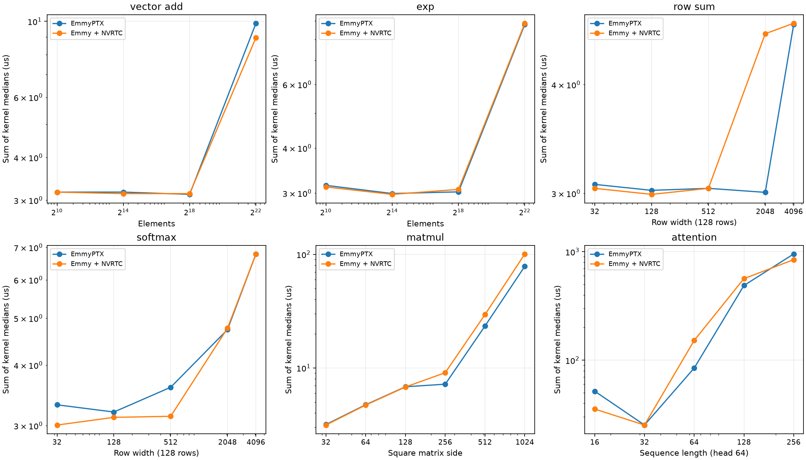
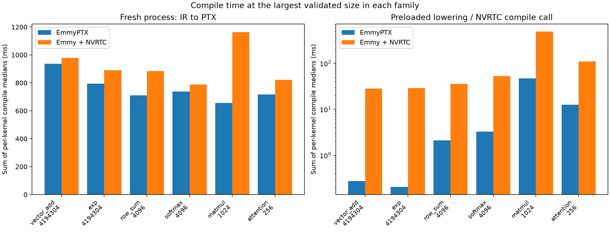

# EmmyPTX versus Emmy + NVRTC

Actual nvcc was not measured. Both paths compile the same scheduled Kernel IR.

Started 2026-10-27T18:06:37.493553+00:00; runner GPU: NVIDIA GeForce RTX 5090 (compute capability 12.0, sm_120). NVRTC options: `['--gpu-architecture=compute_89', '--std=c++17', '--fmad=false']`.
No fast math; implicit CUDA multiply-add contraction disabled. EmmyPTX still fuses explicit reduction products.

CUDA parameter declarations are reordered to match meta.json; the rendered kernel body and schedule are unchanged.

Fresh-process timings include startup, imports, IR loading, rendering and PTX retrieval. Warm IR timings include parsing;
pure lowering uses a preloaded specification. NVRTC call timing excludes rendering, program creation and PTX retrieval.
Compile: one warm-up, 7 samples. GPU: 3 alternating paired rounds,
each with 3 warm-ups and 20 launches. Client response caching is disabled. Clocks are not locked.
Both outputs are fully checked. Timing rounds may omit final output transfers after validation; intermediates are retained.
Execution values sum kernel medians; they exclude transfers and are not end-to-end model latency.

| Workload | Size | EmmyPTX us | NVRTC us | NVRTC / EmmyPTX |
|---|---:|---:|---:|---:|
| vector_add | 1024 | 3.168 | 3.168 | 1.000 |
| exp | 1024 | 3.152 | 3.120 | 0.990 |
| vector_add | 16384 | 3.168 | 3.136 | 0.990 |
| exp | 16384 | 2.992 | 2.976 | 0.995 |
| vector_add | 262144 | 3.120 | 3.136 | 1.005 |
| exp | 262144 | 3.024 | 3.072 | 1.016 |
| vector_add | 4194304 | 9.872 | 8.960 | 0.908 |
| exp | 4194304 | 8.800 | 8.864 | 1.007 |
| row_sum | 32 | 3.072 | 3.040 | 0.990 |
| softmax | 32 | 3.312 | 3.008 | 0.908 |
| row_sum | 128 | 3.024 | 2.992 | 0.989 |
| softmax | 128 | 3.200 | 3.120 | 0.975 |
| row_sum | 512 | 3.040 | 3.040 | 1.000 |
| softmax | 512 | 3.600 | 3.136 | 0.871 |
| row_sum | 2048 | 3.008 | 4.576 | 1.521 |
| softmax | 2048 | 4.736 | 4.768 | 1.007 |
| row_sum | 4096 | 4.688 | 4.704 | 1.003 |
| softmax | 4096 | 6.784 | 6.784 | 1.000 |
| attention | 16 | 51.776 | 35.440 | 0.684 |
| attention | 32 | 25.248 | 25.248 | 1.000 |
| attention | 64 | 84.640 | 152.160 | 1.798 |
| attention | 128 | 487.920 | 564.640 | 1.157 |
| attention | 256 | 952.880 | 844.208 | 0.886 |
| matmul | 32 | 3.168 | 3.136 | 0.990 |
| matmul | 64 | 4.736 | 4.704 | 0.993 |
| matmul | 128 | 6.816 | 6.784 | 0.995 |
| matmul | 256 | 7.184 | 9.072 | 1.263 |
| matmul | 512 | 23.392 | 29.504 | 1.261 |
| matmul | 1024 | 78.464 | 100.768 | 1.284 |

A ratio above 1 favours EmmyPTX. Differences near 1 can be measurement noise.

| Workload | Process EmmyPTX / NVRTC ms | Warm IR ms | Lowering / NVRTC call ms |
|---|---:|---:|---:|
| p_bench_vector_add_1024 | 939.994 / 928.084 | 1.870 | 0.253 / 25.561 |
| p_bench_exp_1024 | 1341.904 / 1017.641 | 1.628 | 0.344 / 36.221 |
| p_bench_vector_add_16384 | 1019.500 / 934.129 | 2.524 | 0.274 / 28.152 |
| p_bench_exp_16384 | 911.088 / 999.810 | 1.339 | 0.205 / 27.694 |
| p_bench_vector_add_262144 | 837.992 / 977.740 | 1.773 | 0.239 / 24.060 |
| p_bench_exp_262144 | 950.822 / 902.595 | 1.176 | 0.265 / 28.328 |
| p_bench_vector_add_4194304 | 936.389 / 979.238 | 2.031 | 0.273 / 27.979 |
| p_bench_exp_4194304 | 793.682 / 889.769 | 1.379 | 0.205 / 29.023 |
| r_bench_row_sum_32 | 716.879 / 767.290 | 1.799 | 0.541 / 27.934 |
| f_bench_softmax_32 | 771.099 / 810.286 | 3.206 | 1.560 / 44.531 |
| r_bench_row_sum_128 | 745.803 / 709.194 | 1.781 | 0.480 / 27.250 |
| f_bench_softmax_128 | 808.973 / 984.177 | 3.783 | 1.835 / 58.983 |
| r_bench_row_sum_512 | 721.817 / 771.892 | 2.244 | 0.770 / 34.178 |
| f_bench_softmax_512 | 738.451 / 838.807 | 5.501 | 2.766 / 47.618 |
| r_bench_row_sum_2048 | 712.273 / 725.369 | 2.646 | 1.942 / 31.180 |
| f_bench_softmax_2048 | 769.182 / 791.129 | 8.977 | 3.638 / 38.666 |
| r_bench_row_sum_4096 | 711.005 / 884.516 | 3.971 | 2.095 / 35.615 |
| f_bench_softmax_4096 | 737.494 / 788.259 | 5.687 | 3.247 / 52.952 |
| a_bench_attention_16 | 783.767 / 8917.136 | 95.704 | 91.149 / 7432.357 |
| a_bench_attention_32 | 655.963 / 8307.450 | 41.112 | 37.966 / 7617.850 |
| a_bench_attention_64 | 732.298 / 962.156 | 12.429 | 5.256 / 96.263 |
| a_bench_attention_128 | 640.860 / 862.627 | 41.908 | 19.474 / 135.269 |
| a_bench_attention_256 | 717.212 / 822.288 | 24.174 | 12.591 / 110.300 |
| m_bench_matmul_32 | 620.349 / 692.998 | 6.958 | 4.561 / 39.464 |
| m_bench_matmul_64 | 637.373 / 693.332 | 10.726 | 7.993 / 89.536 |
| m_bench_matmul_128 | 623.105 / 661.827 | 40.009 | 22.860 / 54.381 |
| m_bench_matmul_256 | 706.474 / 1475.990 | 107.701 | 77.010 / 900.050 |
| m_bench_matmul_512 | 667.546 / 1160.369 | 61.135 | 48.616 / 531.273 |
| m_bench_matmul_1024 | 656.631 / 1163.929 | 63.384 | 46.735 / 488.073 |

## Compile summary

Median across the 29 validated workload medians (each sums its kernels), in ms:

| Measurement | EmmyPTX | Emmy + NVRTC |
|---|---:|---:|
| Fresh process, IR to PTX | 737.494 | 889.769 |
| Warm IR compilation | 3.971 | not measured separately |
| Preloaded lowering / NVRTC compile call | 2.095 | 39.464 |

The last row measures different compilation stages; it does not include startup or rendering.

## Skips and failures

- p_bench_vector_add_16777216: skipped: Full output exceeds runner max_return=2^22; no correctness-validated speed claim
- p_bench_exp_16777216: skipped: Full output exceeds runner max_return=2^22; no correctness-validated speed claim

Across validated sizes, NVRTC / EmmyPTX execution ratios range from 0.684 to 1.798.
These measurements compare code generation for fixed schedules, not independently tuned libraries.
No causal explanation for a speed difference is claimed without profiling.

Exact samples, correctness errors, versions, hashes and failures: [raw_results.json](raw_results.json).
